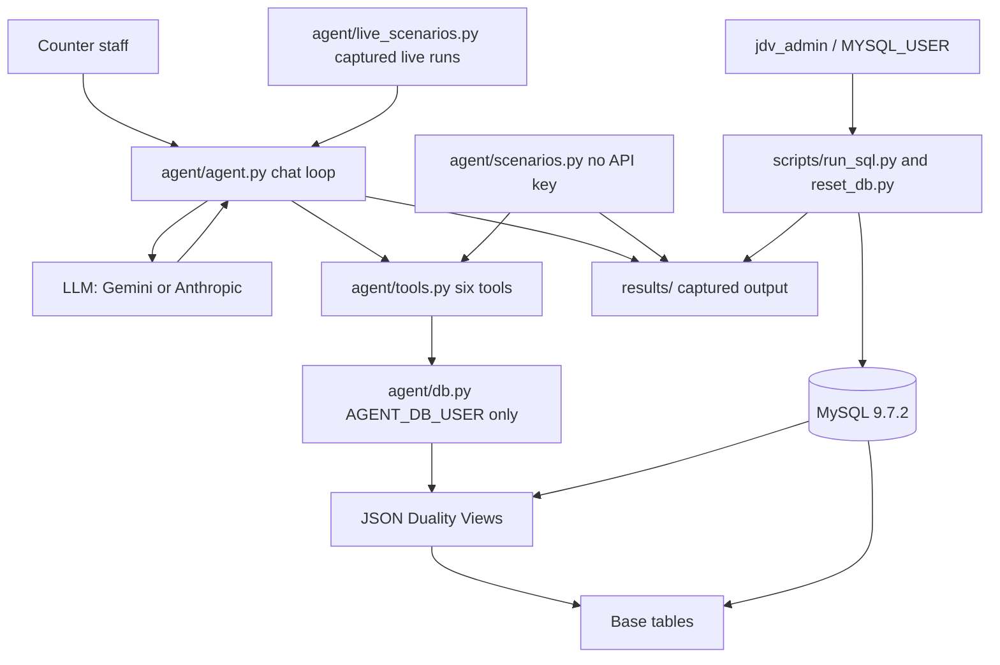
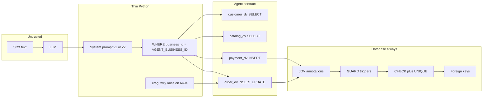
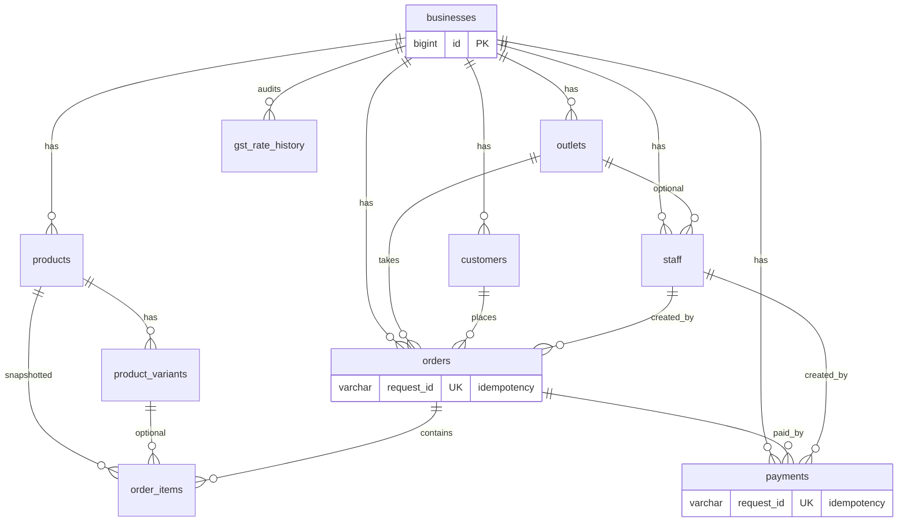
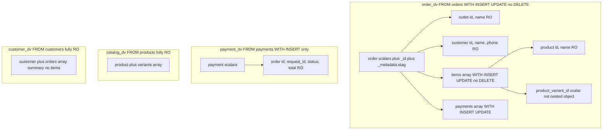
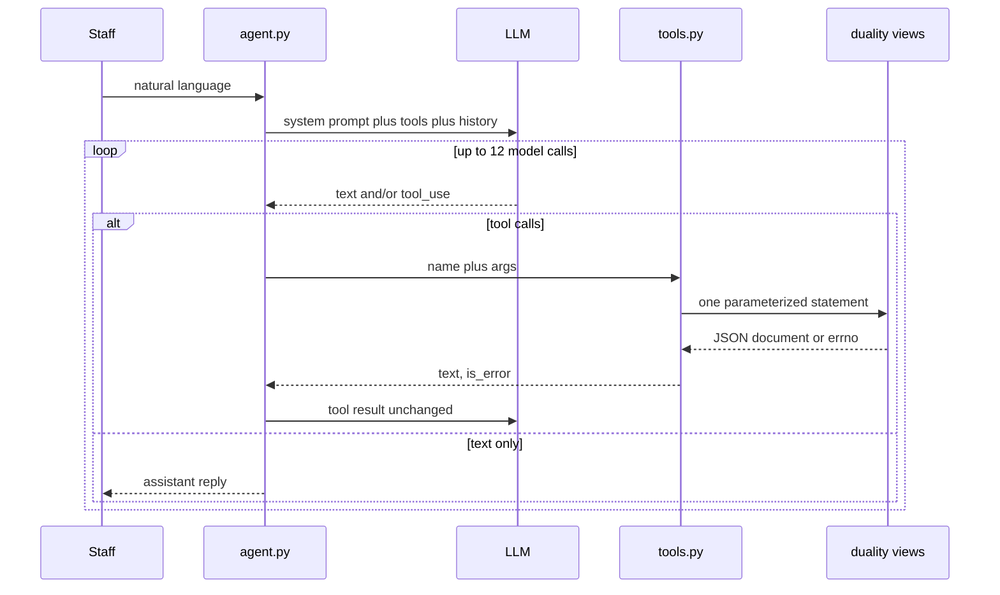
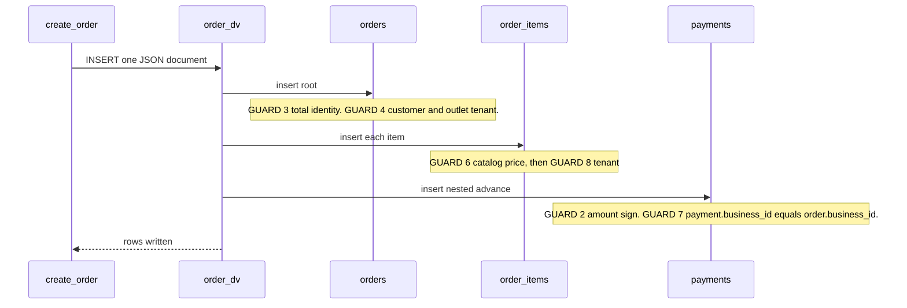
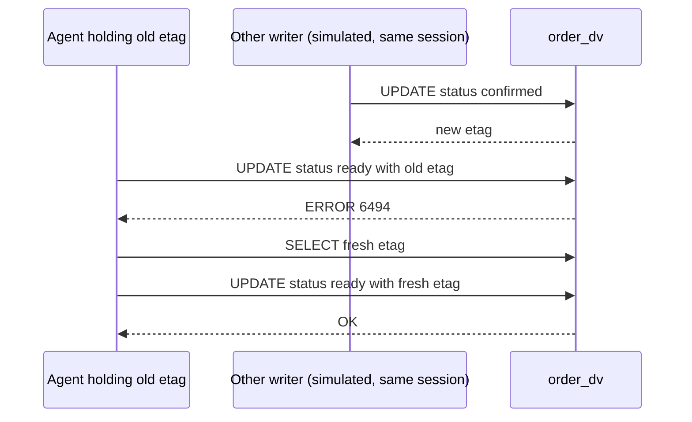

# Architecture

An LLM billing assistant for a bakery that reads and writes **one JSON order
document** while the system of record stays **normalized InnoDB tables**.
MySQL JSON Duality Views (JDV) are both the data shape the agent sees and the
permission boundary it cannot cross. Python holds no write-side business
rules. The only logic in it is the read-side `business_id` filter and a single
etag retry (sections 2 and 5).

Behavioral claims below cite a `results/` file where one exists, as recorded in
[`findings.md`](findings.md); where none exists, the text says so. Diagrams
describe this repo, not an assumed design.

## What this system is

Sunrise Bakers, MG Road outlet (outlet id 1, business id 1). Counter staff
talk to an assistant in plain language. The assistant may only act through
six tools. Each tool runs **one parameterized statement** against a duality
view as `AGENT_DB_USER`, which has grants on those views and none on base
tables. (The exception is the etag retry in `update_order_status`, which can
run up to three statements; see section 5.)

The relational schema (orders, items, payments, catalog, customers) remains
the system of record. The intended split is that POS and reporting use base
tables as `jdv_admin` while the agent never does; that split is a design
intent and was not tested here.

## 1. System context



The server version is MySQL 9.7.2 (`results/45_version.txt`). Three agent-side
clients share the same tools and the same least-privilege account. Admin work
never goes through them.

| Client | Entry | DB user | Purpose |
|---|---|---|---|
| Interactive agent | `python -m agent.agent` | `AGENT_DB_USER` | Staff chat; the LLM chooses tools |
| Scripted proof | `python -m agent.scenarios` | same | Same tools, no API key; each step has an expected OK or error number |
| Live proof | `python -m agent.live_scenarios` | same | Real model on L1–L5; existing transcripts are never overwritten |
| Admin / DBA | `scripts/run_sql.py`, `scripts/reset_db.py` | `MYSQL_USER` (`jdv_admin`) | Schema, seed, edge cases, reporting, catalog price changes |

Captured live runs used Gemini (`AGENT_PROVIDER=gemini`). Anthropic is
implemented in `agent/agent.py` but no live Claude transcript is in
`results/`. Arithmetic in `agent/scenarios.py` only stands in for the model.

## 2. Trust boundaries



Four independent layers, each exercised in [`findings.md`](findings.md):

1. **Grants.** The agent can use the four views, not tables (`ERROR 1142` on
   `SELECT orders`, E13). `catalog_dv` and `customer_dv` are granted
   SELECT only (grants at the end of `sql/02_duality_views.sql`); the
   negative test (E04) was run against `catalog_dv`, not `customer_dv`.
2. **View annotations.** Even `jdv_admin` cannot `UPDATE catalog_dv.price`
   (`ERROR 6497`, E04b). Omitting an item or payment from an `order_dv`
   write is treated as DELETE, which the view refuses (`ERROR 6498`, E02/E03).
   One document per statement (E06–E08).
3. **Triggers and CHECKs.** Tenant, price, payment immutability. (Quantity
   and order-total rules also exist; no negative test is captured for them,
   see the guard map.)
   Table triggers fire for any connection that writes the table; this was
   tested for `jdv_agent` (through `order_dv`) and `jdv_admin` (a direct
   `UPDATE payments`) only (E25/E26, E31c).
4. **Python `WHERE business_id`.** Read-side only, in `agent/tools.py`.
   Duality views have no row-level security, and this repo uses none from
   MySQL itself (MySQL's own position on row-level security was not tested
   here). A grant on `order_dv` is all-or-nothing: the same account can `SELECT`
   another business's order if the `WHERE` is omitted
   ([`when-to-use.md`](when-to-use.md); `agent/scenarios.py` part 2). Writes
   of a cross-tenant document are what the guards stop.

Credentials live only in `.env`. `scripts/run_sql.py` uses a temporary
`--defaults-extra-file` and deletes it. `agent/db.py` never prints the
password. There is no admin fallback in the agent connection.

## 3. Relational schema

The tables are the system of record. Duality views are a document projection
over them, not a second store.



Primary keys are `BIGINT UNSIGNED AUTO_INCREMENT`, not UUIDs
([`porting-notes.md`](porting-notes.md)). Idempotency is
`orders.request_id` / `payments.request_id` (`UNIQUE`; a retry with the same
id is `ERROR 1062`, E15).

Not every table has a duality view. **`gst_rate_history` is reporting-only**
(plain SQL). **`staff` exists so seed data and the concurrency scenario can
name a `created_by`; the agent never writes it.**

Column-level detail belongs in [`schema.md`](schema.md) once that file is
filled in; the CREATE TABLE text is `sql/01_schema.sql`.

Rebuild order (`scripts/reset_db.py`):

1. `sql/reset_drop_database.sql`
2. `sql/00_setup.sql` — database and `AGENT_DB_USER` (no view grants yet)
3. `sql/01_schema.sql` — tables, seed, GUARDS 1–5
4. `sql/02_duality_views.sql` — views and agent grants
5. `sql/06_guards_6_7.sql` — GUARD 6 (item price) and GUARD 7 (payment business)
6. `sql/09_guard_8.sql` — GUARD 8 / 8b (item tenant; immutable `orders.business_id`)

Re-apply **06 then 09 together**. Running 06 alone recreates
`trg_order_items_guard_ins` after the GUARD 8 trigger, so E30f reports GUARD 8
instead of GUARD 6 (`sql/14_trigger_order_evidence.sql`,
`results/14_trigger_order_evidence.txt`).

## 4. Duality views: the agent's entire contract



| View | Root | Nested | Agent grants | Tools |
|---|---|---|---|---|
| `order_dv` | `orders` | outlet, customer, items[], payments[] | SELECT, INSERT, UPDATE | `get_order`, `create_order`, `update_order_status` |
| `payment_dv` | `payments` | order (read-only) | SELECT, INSERT | `add_payment` on an **existing** order |
| `catalog_dv` | `products` | variants[] | SELECT | `search_catalog` |
| `customer_dv` | `customers` | orders[] summary | SELECT | `get_customer` |

Cancel is `order_status = 'cancelled'`, not DELETE. Annotated SQL and
annotation rationale: `sql/02_duality_views.sql` and
[`duality-views.md`](duality-views.md).

Three shapes exist because of measured MySQL behavior, not preference:

- **`product_variant_id` is a flat scalar**, not a nested `product_variant`
  object. A nested read-only singleton that reads back as `null` cannot be
  written back (E20, `results/repro_null_singleton_update.sql`).
- **`order_dv.payments` is `WITH(INSERT, UPDATE)`** so a JSON-text round trip
  of `paid_at` is not treated as a modification (E23). Real edits are
  rejected by GUARD 5. UPDATE on that array is a round-trip concession, not
  a license to change a payment
  ([`duality-views.md`](duality-views.md)).
- **Payments on an already-existing order go through `payment_dv`**, not by
  appending to `order_dv.payments`. Mixing generated and explicit
  AUTO_INCREMENT ids in one nested array is `ERROR 6560` (E16/E24). A client
  cannot know the next id in advance.

## 5. Agent runtime



`agent/agent.py` is a message loop. Vendor specifics (Anthropic Messages API
vs Gemini `google-genai`) sit in marked sections; `AGENT_PROVIDER` selects
one. Gemini pacing (13s between calls) and a single 503/429 retry are in
that section only. The tools and SQL do not change.

`AGENT_PROMPT_VERSION` is required: `v1` or `v2`. v2 adds a unit-from-catalog
rule on `create_order` and a duplicate-open-order instruction in the system
prompt. There is no default.

Transcripts go to `results/agent_transcript.txt` (interactive; this is the
output path in `agent/agent.py`, no such file is captured in the repo) or
`results/agent_live_<provider>_<model>_<version>_<scenario>.txt` (live). API
keys are redacted if they appear in error text.

### The six tools

Each function in `agent/tools.py` runs one statement and returns MySQL's
answer unchanged, except `update_order_status`, which can run up to three
(the update, and on 6494 a re-read of the etag and one retried update).
`business_id` is forced in SQL on writes
(`JSON_SET(..., '$.business_id', AGENT_BUSINESS_ID)`) and filtered on reads.

| Tool | Statement |
|---|---|
| `search_catalog` | `SELECT JSON_ARRAYAGG(data) FROM catalog_dv` filtered by `business_id` and product name |
| `get_customer` | `SELECT data FROM customer_dv` by `business_id` and phone |
| `get_order` | `order_dv` plus `JSON_TABLE` on `$.payments[*]`; **`balance_due` is computed in SQL** |
| `create_order` | `INSERT INTO order_dv VALUES (JSON_SET(doc, '$.business_id', ...))` |
| `add_payment` | `INSERT INTO payment_dv` with `business_id` and `order.id` set in SQL |
| `update_order_status` | `UPDATE order_dv` of `order_status` and etag; on **6494** re-read etag and retry once |

That etag retry is the only write-side logic in Python. Bad tool names or
MySQL errors become `(text, is_error=True)` so the model sees them; the
process does not crash (`tools.call`).

## 6. Write path

Create an order with an optional nested advance:



A later payment is `add_payment` → `INSERT INTO payment_dv`. The nested
`order` object is a read-only reference used to name the parent; it is not
a nested write of the order document.

Status change is `UPDATE order_dv` of `$.order_status` together with
`$._metadata.etag`.

### Read path

Reads are `SELECT` on a view plus a `WHERE` on `JSON_VALUE(data, '$.business_id')`.
`get_order` also accepts `_id` or `request_id`. `search_catalog` uses
`LOCATE` on the lowercased product name. Nothing in Python reshapes the
document except `get_order` asking SQL to add `balance_due`.

`gst_rate_history`, `staff`, and base tables are not on this path for the
agent. `EXPLAIN SELECT` on a duality view works for an account with rights
on the underlying tables; the agent cannot EXPLAIN at all (`ERROR 1345`,
E09b). `EXPLAIN UPDATE` on a duality view is `ERROR 6482` for everyone
(E09c).

## 7. Concurrency

JDV treats the **document** as the unit of change. The etag in
`_metadata.etag` must match.



`agent/scenarios.py` S6–S7 simulates the other writer on the same agent
account, then calls `update_order_status` with the stale etag. The tool
retries once. A second UPDATE that still sends the replaced etag is E01
(`ERROR 6494`).

Leaving an array element out of the document means delete it. `order_dv`
does not allow DELETE on items or payments, so that write is `ERROR 6498`
(E02, E03). Primary keys cannot be changed through the view (E05). Nested
array order does not matter; elements are matched by key (E22).

## 8. Guard map

Guards 1–5 live in `sql/01_schema.sql`. Guards 6–7 are `sql/06_guards_6_7.sql`.
Guards 8 and 8b are `sql/09_guard_8.sql`. The `order_id` lock is part of
GUARD 6's UPDATE trigger (`sql/13_e33_order_id_guard.sql` records the
after-state; the lock itself is in `06`).

| Guard | Where | Rule | Evidence |
|---|---|---|---|
| 1 | CHECK `order_items.qty > 0` | Quantity | no negative test captured |
| 2 | CHECK on `payments` | Refund amount &lt; 0; other types &gt; 0 | REFUND1 (a -500.00 refund is accepted) and REFUND2 (a positive refund is rejected, `ERROR 3819`); the "other types &gt; 0" half has no negative test |
| 3 | BEFORE INSERT/UPDATE `orders` | `total = subtotal - discount_value + gst_value` | no negative test captured |
| 4 | same | customer and outlet belong to `orders.business_id` | E11 |
| 5 | BEFORE UPDATE `payments` | No column may change | E25 agent via `order_dv`; E26 admin `UPDATE payments` |
| 6 | INSERT/UPDATE `order_items` | Price matches catalog on insert; `price`, `product_id`, `product_variant_id`, `order_id` immutable after insert | E28, E33 |
| 7 | INSERT `payments` | `payments.business_id` equals the order's business | E29 |
| 8 | INSERT `order_items` | Product and variant belong to the order's business | E30 after `09`; G7 in `agent/scenarios.py` |
| 8b | UPDATE `orders` | `business_id` immutable | E31b, E31c |
| Unique | `request_id` on orders and payments | Retry does not insert a second row | E15, G3 |

On `order_items` INSERT, GUARD 6 is created first and GUARD 8 `FOLLOWS` it, so
an item that is both wrong-tenant and wrong-price reports **GUARD 6** (E30f).
On `orders` UPDATE, GUARD 3/4 fire before 8b (E31a reports GUARD 4).

**Known limits.** Six things this database does not enforce, or that were not
tested. The full entries, with evidence, are in
[Known limits in `findings.md`](findings.md#known-limits):

1. A payment can push the total paid above the order total.
2. Item `gst_value` is not required to add up to the order's `gst_value`.
3. `udhaar_settlement` payments may not map to one order's total.
4. Cancelled orders, and lowering `orders.total` below the amount already
   paid, are not covered.
5. An administrator can still change `products.business_id`
   ([`when-to-use.md`](when-to-use.md)).
6. Changing an item's `order_id` through `order_dv` is untested; the lock was
   proven only with a direct `UPDATE order_items` (E33).

Separately, reads across tenants remain possible if a client skips the Python
`WHERE` (section 2).

## 9. What lives where

| Concern | Location | Not in |
|---|---|---|
| Document shape | `sql/02_duality_views.sql` | Python |
| Tenant write consistency | GUARDS 4, 7, 8, 8b | Python |
| Tenant **read** filter | `agent/tools.py` only | MySQL |
| Item prices on insert | GUARD 6 plus catalog columns | The agent “fixing” a number after a reject |
| Payment history | Insert a refund; never UPDATE a payment | The UPDATE annotation on `order_dv.payments` (round-trip only) |
| Idempotency | `request_id` UNIQUE | UUID primary keys (deliberately not used) |
| LLM vendor | Marked sections in `agent/agent.py` | Tools and SQL |
| Evidence for a claim | `results/*.txt` cited from [`findings.md`](findings.md) | A comment that was not run |

## 10. Repository map

```
sql/00–02, 06, 09     rebuild: users, schema, views, guards
sql/03, 04, 05        happy-path DML, edge cases, SQL scenario
sql/07, 08, 10–14     guard proofs (before/after GUARD 8, E33 lock)
sql/45, 47, 48        version, manual vs DV, admin grants
agent/db.py           AGENT_DB_USER, autocommit, password never logged
agent/tools.py        six tools, business_id WHERE, etag retry
agent/agent.py        provider loop, transcript
agent/scenarios.py    scripted S1–S10 and G1–G7
agent/live_scenarios.py  L1–L5 against a live model
scripts/run_sql.py    mysql via a temp defaults-extra-file
scripts/reset_db.py   drop through 09, in order
results/              committed evidence
docs/                 this file, findings, view notes, when-to-use, porting
```

`reference-local/` is git-ignored; nothing in it is tracked. Public docs
do not name the application this was ported from.

## 11. When the duality-view path is the right one

Use the views for **one-document agent I/O** with database-side guards.

Do not use them for bulk load, set-based updates, upserts, or agent-side
`EXPLAIN` (E06–E09c). POS, reporting, and catalog maintenance stay on **base
tables** as an admin. That split is the architecture.

Guidance and the read-side RLS gap: [`when-to-use.md`](when-to-use.md).
Porting background: [`porting-notes.md`](porting-notes.md).

## Related docs

- [`schema.md`](schema.md) — table reference (planned)
- [`duality-views.md`](duality-views.md) — each view, annotations, payments rule
- [`findings.md`](findings.md) — every test, expected vs actual
- [`when-to-use.md`](when-to-use.md) — JDV vs alternatives; RLS limitation
- [`porting-notes.md`](porting-notes.md) — AUTO_INCREMENT, `request_id`, no RLS
- [`setup.md`](setup.md) — accounts and grants
